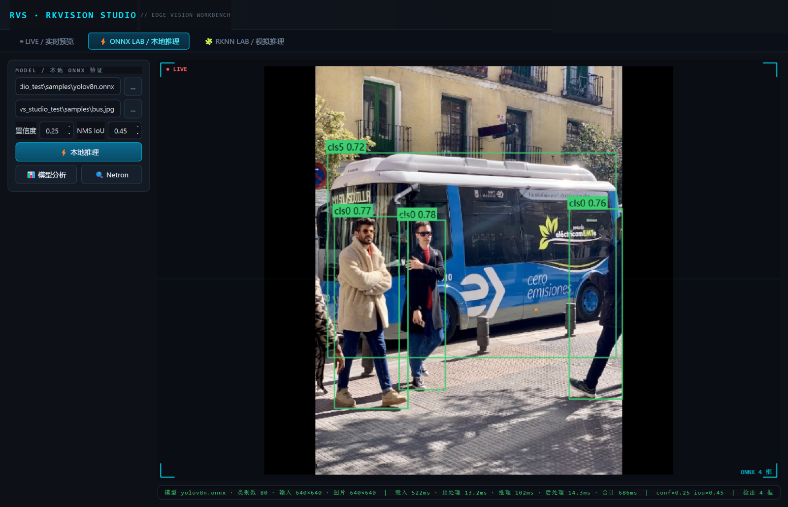
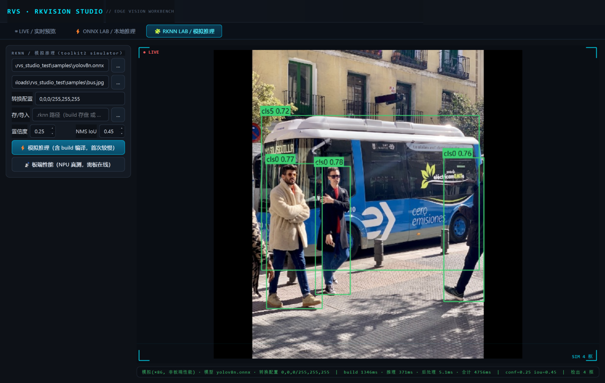

# RKVision Studio

> 把「模型 → RKNN → 板上 NPU → 实时画面」这条链，装进一个工作台。
> One workbench for the whole edge-AI chain: model → RKNN → on-board NPU → live video.

**RKVision Studio** 是一套面向 Rockchip RK3576/RK356x NPU 的开源边缘视觉工作台：PC 端 Qt 桌面（实时预览 + ONNX LAB + RKNN LAB）+ 板端 C++ 插件式推理引擎 + Android 相机推流 App，覆盖从模型调参到板上交付的完整链路。

**如果你遇到过这些事，它是为你准备的：**

- 拿着 rknn_model_zoo 的 demo 改模型——换个输出头就要重读一遍 C++；
- 在 toolkit2 CLI、adb、手写验证脚本之间来回切，转换前后对不上号；
- 改了一行后处理，只能靠肉眼确认检测结果没变。

**它的回答：**

- `pipeline.json` 声明式流水线：source → preprocess → infer → post → sink，换模型/换后处理零代码，新增算子即新增一个 `REGISTER_STAGE` 文件；
- **双 LAB 对照**：同一张图同一套阈值，ONNX（onnxruntime）与 RKNN（toolkit2 模拟器）并排跑，逐框数值一致才算数；RKNN LAB 的副产品就是可上板的 `.rknn`；
- **金标准逐位回归**：板上输出张量级比对（gold_regression），后处理改动是否影响结果，机器说了算；
- **一键部署闭环**：交叉编译 → adb 推送 → 板上执行 → 结果拉回，一条命令。

| ONNX LAB —— 本地推理 + 阈值调节 + 模型分析 | RKNN LAB —— toolkit2 模拟推理 + 一键转换 |
|---|---|
|  |  |

```
┌─────────────────────────── PC（Windows + WSL）────────────────────────────┐
│  Qt Studio (rvs_studio.exe)                                              │
│  ├─ LIVE    板端预览（MJPEG 直连 / RTSP）+ 实时推理叠加 + 板端状态条       │
│  ├─ ONNX LAB  本地图片 × 本地 ONNX：阈值调节 / 模型分析(参数量·MACs·逐层)  │
│  ├─ RKNN LAB  toolkit2 模拟器推理 + 逐层剖析 + 一键转换 .rknn             │
│  └─ 部署    一键交叉编译产物 + 工程包 push 到板端并执行                    │
│        │ QProcess(u32LE JSON 帧)          │ adb push/reverse              │
│  ┌─────▼─────────────────┐         ┌──────▼───────────────────────┐      │
│  │ WSL python3 工具链     │         │  mediamtx (RTSP)  ◄── rvs-cam │      │
│  │ onnxruntime / rknn    │         └──────────────────────────────┘      │
│  └───────────────────────┘                 │ RTSP/MJPEG                  │
└────────────────────────────────────────────┼─────────────────────────────┘
                                             ▼
┌────────────────────────── 板（RK3576，Android）───────────────────────────┐
│  rvs_engine —— 插件式流水线引擎                                           │
│  source(v4l2/image_dir) → preprocess(letterbox) → infer(rknn)             │
│                          → post(yolov5/yolov8) → sink(image_out/mjpeg)    │
│  pipeline.json 声明拓扑与参数，插件 so-free（编译期注册），零代码组工程     │
└───────────────────────────────────────────────────────────────────────────┘
```

## 目录结构

```
engine/        板端 C++ 引擎（core 流水线 + stages 插件）
studio/        Python 包：打包/部署/对照（板上执行 + 金标准比对）
studio-qt/     PC 端 Qt 6 桌面工作台
tools/         WSL 侧推理/分析/性能脚本（onnxruntime + rknn-toolkit2）
app-rvscam/    Android 相机推流 App（MJPEG → PC/mediamtx）
projects/      工程包示例（pipeline.json + 资产）
scripts/       构建/验证脚本
cmake/         板端交叉编译工具链包装
docs/          设计文档、构建与验证手册、工作流设计
```

## 构建

### 1) PC 端引擎 + 单元测试（Linux/WSL）

```bash
sudo apt install cmake g++ libopencv-dev
./scripts/build_host.sh && ctest --test-dir build-host --output-on-failure
```

### 2) 板端引擎（交叉编译，RK3576 aarch64/Android）

Rockchip SDK 与 OpenCV Android 库不随本仓库分发，须自行准备并以环境变量/`-D` 传入：

```bash
export ANDROID_NDK_ROOT=~/android-ndk-r18b                    # NDK（r18b 已验证）
export RVS_RKNN_SDK_DIR=~/rknn-toolkit2/rknpu2                # 上游: github.com/airockchip/rknn-toolkit2
export RVS_OPENCV_ANDROID_DIR=~/opencv-android-sdk-build/sdk/native
# 可选（M0 基线对照 demo）: export RVS_BASELINE_DEMO_DIR=~/mydemos/algorithm-helmet
./scripts/build_board.sh
```

### 3) PC 端 Qt 工作台（Windows + Qt 6.7）

```bash
cmake -S studio-qt -B build-qt -DCMAKE_PREFIX_PATH=C:/Qt/6.7.3/mingw_64 -G "MinGW Makefiles"
cmake --build build-qt -j
```

说明：Qt 工作台通过 `wsl.exe` 调用本仓库 `tools/` 下的 python 脚本，`RVS_TOOLS_DIR`/`RVS_WSL_DISTRO` 在 CMake 配置期注入，无需改源码。

### 4) Android 推流 App

```bash
cd app-rvscam && ./gradlew assembleDebug
```

## 模型与资产

仓库**不含**模型文件与业务资产（`.rknn`/金标准张量/测试图片均不入库）。用你自己的 ONNX 走 ONNX LAB，或用 RKNN LAB 从 ONNX 一键转出目标板 `.rknn`。`scripts/fetch_gold.sh.example` 是金标准 fixtures 的用法模板。

## 第三方组件

| 组件 | 许可 | 用途 |
|---|---|---|
| [rknn-toolkit2 / rknpu2](https://github.com/airockchip/rknn-toolkit2) | 专有（Rockchip） | 板端 runtime 与转换工具，**不随仓库分发**，见其上游 |
| [rknn_model_zoo](https://github.com/airockchip/rknn_model_zoo) 示例 | Apache-2.0 | `postprocess_yolov5` 参考其实现 |
| [OpenCV](https://opencv.org) (≥4.5) | Apache-2.0 | 图像处理（host 动态 / Android 静态） |
| [nlohmann/json](https://github.com/nlohmann/json) | MIT | `pipeline.json` 解析（随仓库单头分发） |
| [onnxruntime](https://onnxruntime.ai) | MIT | PC 端 ONNX 推理（WSL 侧 pip 安装） |
| Qt 6 | LGPLv3/GPL | 桌面工作台 |

## 文档

- [docs/2026-10-16-框架设计.md](docs/2026-10-16-框架设计.md) —— 架构与插件机制
- [docs/2026-10-17-构建与验证手册.md](docs/2026-10-17-构建与验证手册.md) —— 从零到板上跑通的操作手册
- [docs/2026-10-18-工业工作流设计.md](docs/2026-10-18-工业工作流设计.md) —— 工业视觉任务模板 / 判决 DSL / 路线图

## License

Apache-2.0（见 [LICENSE](LICENSE)）。Rockchip SDK（rknpu2 runtime、toolkit2）为专有组件，由使用者自行从上游获取并遵守其许可。
